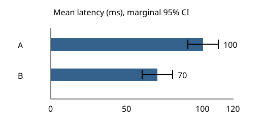

# Fictional visual-review fixture

These are synthetic teaching artifacts, not a real study. Review only the
supplied evidence; no raw observations or final paginated PDF are available.

## Results

Figure 1 shows that method B reduces mean latency by 30% compared with method A.
The error bars establish that the paired improvement is statistically significant.

Figure 1. Mean latency in milliseconds for A and B; bars show marginal 95%
confidence intervals for each mean. Each method has 20 observations. Underlying
summary values are in summary.csv; interval construction and pairing are not
documented in this fixture.

## Conceptual model

Figure 2 is the proposed processing sequence: Input -> Filter -> Output.
This schematic alone demonstrates the filter's accuracy on unseen samples.

Figure 2. Conceptual processing stages; no performance measurements are shown.
